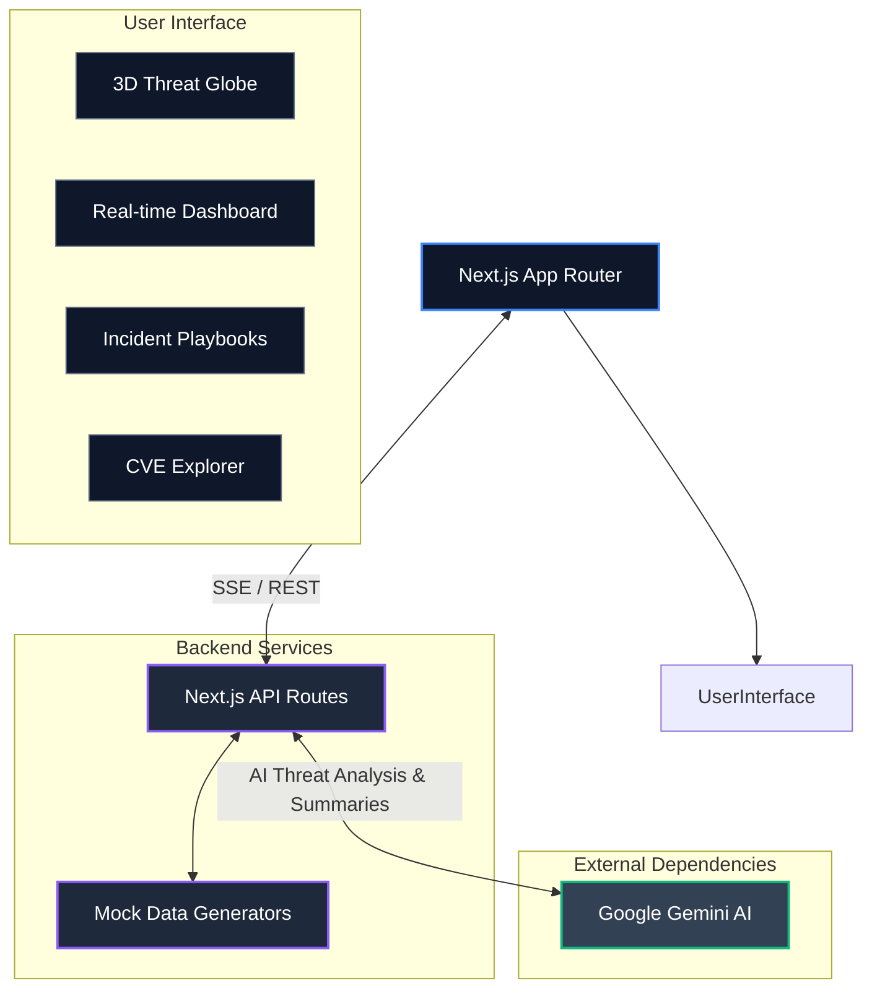

# PRAGMA 🛡️

**PRAGMA** is an advanced, enterprise-grade Cyber Threat Intelligence Engine designed to provide real-time threat analysis, network monitoring, and rapid incident response playbooks. Built with a stunning, high-fidelity user interface, PRAGMA leverages Gemini AI to parse complex indicators of compromise (IOCs) and generate actionable intelligence for security operation centers (SOC).


## 🔥 Core Features

*   **Real-time Threat Feed:** Live ingestion of global threat vectors visualized dynamically.
*   **AI-Powered Threat Analysis:** Integration with Google Gemini AI to analyze raw data (IPs, URLs, hashes) and generate executive summaries, technical breakdowns, and MITRE ATT&CK mappings.
*   **Automated Incident Response Playbooks:** Generate prioritized, actionable step-by-step containment and eradication playbooks on the fly during a crisis.
*   **3D Globe Visualization:** Interactive geospatial threat mapping using React Three Fiber.
*   **Vulnerability Database Explorer:** Search and review current CVEs with AI-enhanced "Executive Summaries" clarifying risks in plain English.
*   **Enterprise Integration Ready:** Architected with a robust, modular Next.js structure scalable for mock B2B integrations.

## 🛠️ Technology Stack

PRAGMA is built on a modern, high-performance web stack:

*   **Framework:** [Next.js](https://nextjs.org/) (App Router)
*   **UI & Animations:** [Framer Motion](https://www.framer.com/motion/)
*   **Data Visualization:** [D3.js](https://d3js.org/) & [React Three Fiber](https://r3f.docs.pmnd.rs/) (for the 3D globe)
*   **Icons:** [Lucide React](https://lucide.dev/)
*   **AI Integration:** `@google/generative-ai` (Gemini API)

## 🚀 Getting Started

### Prerequisites

*   Node.js (v18.x or higher)
*   A Google Gemini API key

### Installation

1.  **Clone the repository:**
    ```bash
    git clone https://github.com/nika619/PRAGMA.git
    cd PRAGMA
    ```

2.  **Install dependencies:**
    ```bash
    npm install
    # or
    yarn install
    ```

3.  **Configure Environment Variables:**
    Copy the `.env.example` file to `.env.local` and add your keys:
    ```bash
    cp .env.example .env.local
    ```
    Ensure your `.env.local` contains:
    ```env
    GEMINI_API_KEY="your_actual_gemini_api_key_here"
    ```
    *(Note: If the key is absent or hits limit, PRAGMA gracefully falls back to mock responses for demonstration purposes).*

4.  **Run the Development Server:**
    ```bash
    npm run dev
    # or
    yarn dev
    ```

5.  **Open the Application:**
    Navigate to [http://localhost:3000](http://localhost:3000) in your browser to view the application.

## 📂 Project Architecture



*   `/app`: Next.js App Router providing the core application pages.
*   `/components`: Reusable React components organized by domains (`layout`, `shared`, etc.).
*   `/hooks`: Custom React hooks for state and data management.
*   `/lib`: Core utility functions, API clients, and mock data fallbacks used for reliable demonstrations.
*   `/public`: Static assets.

## 🤝 Contributing

Contributions, issues, and feature requests are welcome! Feel free to check the [issues page](https://github.com/nika619/PRAGMA/issues).

## 📝 License

This project is licensed under the MIT License - see the LICENSE file for details.

---
*Built for the future of Cyber Defense.*


---

Built by [Mayank Tiwari](https://github.com/nika619) · [Hire me on Contra](https://contra.com/mayank_tiwari_a4vkcjsh)
